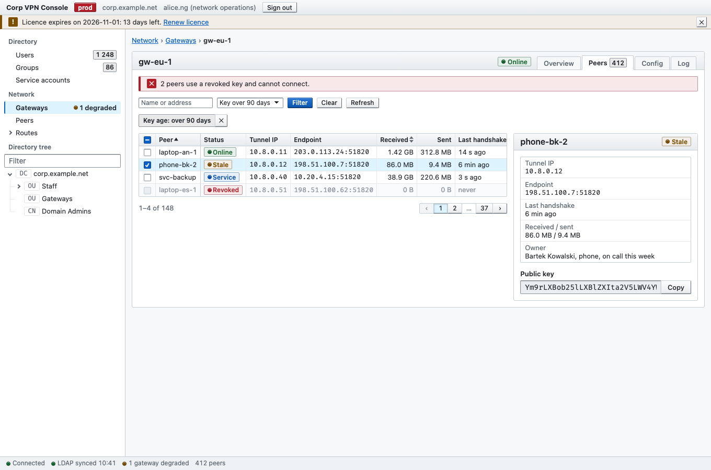

# Cubicle

A dense, tactile, accessible CSS framework for critical enterprise tools: identity and access
management portals, VPN admin panels, infrastructure consoles and back-office dashboards.



- **Made for operators.** Twenty to thirty table rows on a 1080p screen, monospace for every IP, key
  and hash, and tabular figures that line up.
- **Controls look like what they do.** Raised keys travel 1px when pressed, fields are recessed, and
  every state (current, selected, busy, invalid, disabled) is unambiguous.
- **One hand-written file.** `dist/cubicle.css` has no build step and no runtime dependencies.
  `dist/cubicle.js` is optional progressive enhancement.

## Quick start

Copy `dist/cubicle.css`, and optionally `dist/cubicle.js`, into your project and link them:

```html
<!doctype html>
<html lang="en">
<head>
  <meta charset="utf-8">
  <meta name="viewport" content="width=device-width, initial-scale=1">
  <link rel="stylesheet" href="cubicle.css">
  <script src="cubicle.js" defer></script>
</head>
<body>
  <div class="cb-app">
    <header class="cb-app__top"><strong>VPN Console</strong></header>
    <nav class="cb-app__side cb-nav" aria-label="Console">
      <ul class="cb-nav__list">
        <li><a class="cb-nav__link" href="/gateways" aria-current="page">Gateways</a></li>
      </ul>
    </nav>
    <main class="cb-app__main">
      <button class="cb-btn cb-btn--primary" type="button">Add gateway</button>
    </main>
    <footer class="cb-app__status"><span class="cb-led cb-led--ok">Connected</span></footer>
  </div>
</body>
</html>
```

There are no releases, CDN links or packages yet; they arrive with the first tagged release.

Open [`docs/index.html`](docs/index.html) for the full catalogue: every component in every state,
with a copy-paste snippet that is identical to the live markup. Open
[`docs/example.html`](docs/example.html) for a complete console screen.

## Components

Everything is opt-in: Cubicle styles only elements with a `cb-*` class, plus the document's body
text, links, monospace elements and the focus ring.

| Component | Main classes and attributes | Catalogue |
|---|---|---|
| Application shell | `.cb-app` with `__top`, `__banner`, `__side`, `__main`, `__status` | [Layout](docs/index.html#layout) |
| Layout primitives | `.cb-stack`, `.cb-cluster`, `.cb-grid--2` / `--3` / `--4` | [Layout](docs/index.html#layout) |
| Buttons | `.cb-btn`, `--primary`, `--danger`, `--danger-solid`, `--sm`, `--icon`, `.cb-btn-group`; `aria-pressed`, `aria-busy`, `aria-disabled` | [Buttons](docs/index.html#buttons) |
| Fields and choices | `.cb-input`, `.cb-select`, `.cb-check`, `.cb-choice`, `.cb-field` (`--horizontal`), `.cb-input-group`, `.cb-range`; `readonly`, `aria-invalid`, `aria-disabled` | [Inputs & fields](docs/index.html#fields) |
| Secret boxes | `.cb-secret`; `data-cb-copy`, `data-cb-reveal`, `data-cb-download` | [Secret boxes](docs/index.html#secrets) |
| Fieldsets and panels | `.cb-fieldset`, `.cb-panel` with `__head`, `__title`, `__body`, `__foot`; `--inset`, status stripes, `<details>` panels; group errors through `aria-invalid` choices | [Fieldsets & panels](docs/index.html#panels) |
| Tabs | `.cb-tabs`, `__list`, `__tab`, `__panel`; link tabs with `aria-current`, ARIA tabs with `data-cb-tabs` | [Tabs](docs/index.html#tabs) |
| Data tables | `.cb-table-wrap`, `.cb-table`, `--compact`, `--wrap`, `--sticky`, `__num`, `__select`, `__actions`, `__sort`; `aria-selected`, `aria-sort`, `data-cb-select-all` | [Data tables](docs/index.html#tables) |
| Badges and LEDs | `.cb-badge` (`--ok`, `--warn`, `--danger`, `--info`, `--off`, `--solid`, `--count`), `.cb-led` | [Status badges & LEDs](docs/index.html#badges) |
| Alerts | `.cb-alert` (tones, `--sm`, `--banner`), `__title`, `__actions`, `__close`; `data-cb-dismiss` | [Alerts](docs/index.html#alerts) |
| Navigation and trees | `.cb-nav`, `__list`, `__link`, `__kind`, `--lines`, `.cb-breadcrumb`; `aria-current`, `data-cb-tree` | [Tree views & navigation](docs/index.html#nav) |
| Meters and progress | `.cb-meter` on `<meter>` and `<progress>`, `--sm`, `--ticks`, `.cb-gauge`; `data-cb-marks` | [Meters & progress](docs/index.html#meters) |
| Segmented controls | `.cb-btn-group.cb-segmented` with radios or checkboxes, `--fill` | [Segmented controls](docs/index.html#segmented) |
| Details | `.cb-details`, `__body`, `--sm`, `--inline`; `<details name>` accordions | [Details & disclosure](docs/index.html#details) |
| Dialogs | `.cb-dialog` (`--sm`, `--lg`, `--danger`) with the panel parts; `popover`, `data-cb-modal` | [Modals & dialogs](docs/index.html#dialogs) |
| Pagination | `.cb-pagination`, `__summary`, `__pages`, `__sizes`, `__gap`, `__jump`, `--spaced` | [Pagination](docs/index.html#pagination) |
| Inline code and keys | `.cb-code`, `.cb-kbd` | [Utilities](docs/index.html#utilities) |
| Utilities | `.cb-mono`, `.cb-num`, `.cb-muted`, `.cb-text-*`, `.cb-truncate`, `.cb-nowrap`, `.cb-break`, `.cb-sr-only`, `.cb-skip-link` | [Utilities](docs/index.html#utilities) |

## `cubicle.js`

The script is optional. It works through `data-cb-*` attributes with delegated listeners on the
document, so markup swapped in later (HTMX, frameworks) needs no initialisation. Each value is the
id of the target element.

| Attribute | On | Behaviour |
|---|---|---|
| `data-cb-copy="id"` | button | Copies the target's value or text; falls back to a hidden buffer on plain HTTP and announces the result |
| `data-cb-reveal="id"` | button with `aria-pressed` | Shows or masks a password field; `data-cb-reveal-timeout="30"` masks it again |
| `data-cb-download="id"` | button | Saves the target's text as a file named by `data-cb-filename` |
| `data-cb-select-all="id"` | header checkbox | Checks every row box of the table; shows the mixed state |
| `data-cb-dismiss="id"` | button | Hides the target (an alert) and moves focus on |
| `data-cb-tabs` | tab set | Click, arrow keys, Home and End switch ARIA tabs |
| `data-cb-tree` | tree | Arrow keys, Home, End, Enter and Space walk, open and select tree items; fires `cb-toggle` |
| `data-cb-marks` | `<meter>` | Marks `low` and `high` on the ruler |
| `data-cb-modal="id"` | button | Opens the `<dialog>` as a modal |
| `data-cb-output` | `<output for="id">` | Shows the current value of its control (a range, a number) |

Without the script, buttons that only the script can serve are hidden, ARIA tab sets show every
panel, and trees show every branch.

## Customisation

**Tokens.** Every colour, radius, shadow, duration, size and spacing step is a `--cb-*` custom
property. Override any of them in your own, unlayered CSS:

```css
:root {
  --cb-accent: #24527a;
}
```

**Components.** The stylesheet is split into cascade layers (`reset, tokens, base, layout,
components, utilities`). Any unlayered rule of yours wins over all of them, so overrides never need
`!important`.

**Density.** Put `data-cb-density="compact"` or `"comfortable"` on `<html>` or on any panel, table
or form. Control heights, row heights and the small spacing steps change; type sizes do not.

**Server-driven pages.** State lives in standard attributes (`aria-current`, `aria-selected`,
`aria-pressed`, `aria-expanded`, `aria-invalid`, `aria-busy`, `disabled`, `open`), so HTMX swaps and
framework renders need no class juggling.

Cubicle is light only; it declares `color-scheme: light`.

## Accessibility

Text meets WCAG AA contrast (4.5:1) and boundaries, fills and the focus ring meet 3:1, as measured
in the browser for every palette pair. Every control has a visible focus ring and a keyboard path,
and the only animation stops under `prefers-reduced-motion`. See the
[Accessibility section](docs/index.html#accessibility) for the contrast table and the keyboard map.

## Browser support

Cubicle targets Baseline "widely available" features in evergreen browsers (cascade layers, native
nesting, `color-mix()`, `:has()`, container queries). The whole verification suite passes in
Chromium, Firefox and WebKit. Known engine differences:

- Firefox draws no ruler strip under meters, so ticks and threshold marks are absent there.
- In Safari, Tab reaches links and buttons only with Option+Tab (the platform default).
- Safari keeps its own grey selection in list boxes (`<select multiple>`); other engines show the
  selected tint.
- Number and search fields have no engine keys. Escape clears a search field, except in Safari.
- Firefox and Safari show month and week fields as text fields; Firefox does not focus a readonly
  date or time field.

Sizes: `cubicle.css` 86 KB (21 KB gzip), minified 45 KB (8.6 KB gzip); `cubicle.js` 16 KB
(5.1 KB gzip), minified 7.1 KB (2.7 KB gzip).

## Development

Using Cubicle needs no tools. Working on it uses a few Node scripts in `scripts/`:

| Command | Purpose |
|---|---|
| `node scripts/check-snippets.mjs` | Every catalogue demo matches its copy-paste snippet |
| `node scripts/check-tokens.mjs` | Every token is documented with its value, and every `var(--cb-*)` is declared |
| `node scripts/verify-browser.mjs [page] --browser chromium\|firefox\|webkit` | Contrast, focus, keyboard, layout and behaviour checks in a real browser; `--only <groups>` for a quick partial run |
| `node scripts/verify-matrix.mjs [--min]` | The same checks for both pages in all three engines, side by side, with one summary |
| `bash scripts/build-min.sh` | Builds `dist/*.min.*` for release checks |

See [CONTRIBUTING.md](CONTRIBUTING.md) for setup, rules and the definition of done, and
[AGENTS.md](AGENTS.md) for the full specification.

## License

[MIT](LICENSE)
